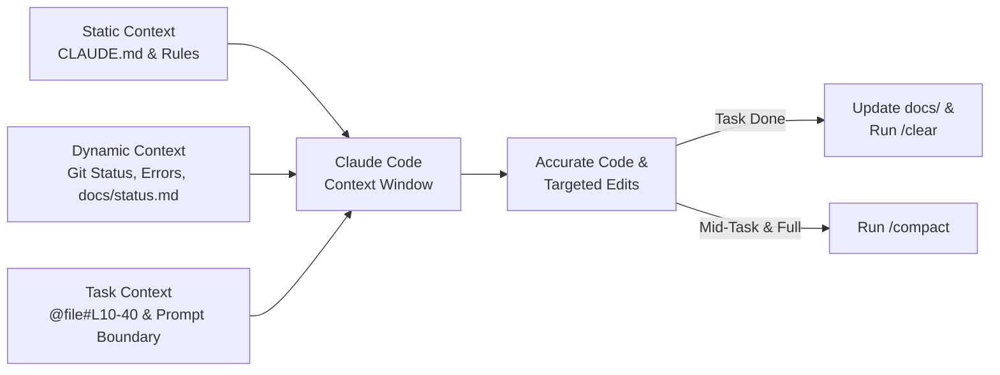
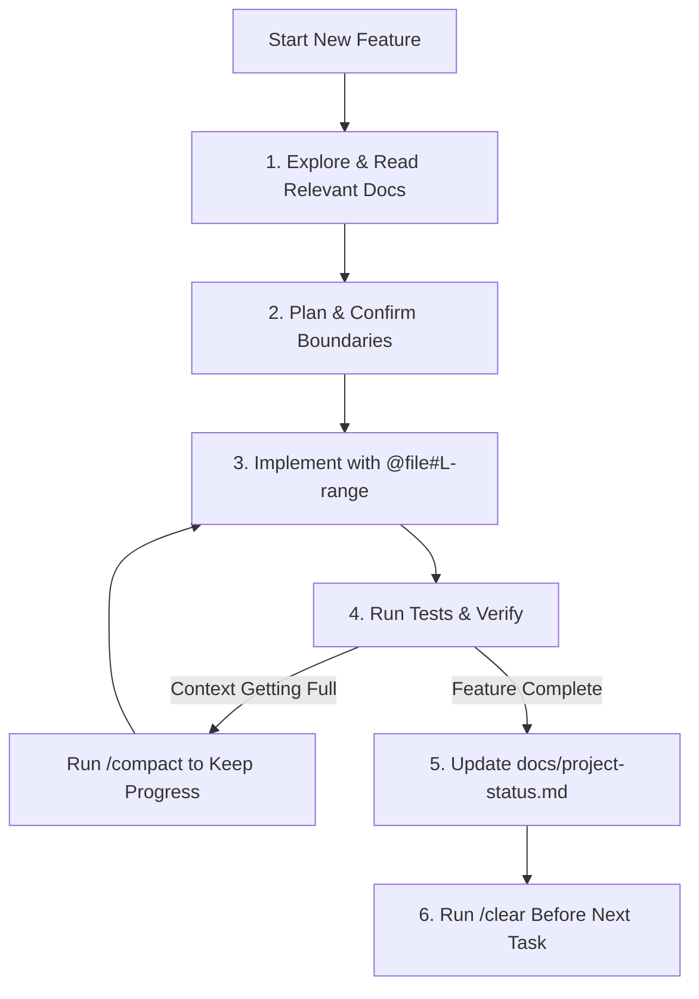

# Context Engineering with Claude Code 

**Context engineering** is the practice of selecting, structuring, and feeding the exact information an AI coding agent needs to make accurate decisions—without drowning it in irrelevant files.

* **Prompt Engineering:** *How* you instruct the model (tone, role, output format).
* **Context Engineering:** *What information* the model sees when making decisions (rules, code, errors, constraints).

> **Golden Principle:** **Relevant context beats more context.** Dumping an entire codebase increases noise, wastes tokens, and causes hallucinations. Give only the context that changes how the agent solves the current task.

---

## 1. The Context Window & 3 Layers of Context

Think of Claude Code like a newly hired engineer on Day 1. Without knowing your stack, folder structure, or conventions, it will guess. You prevent guessing by structuring context into three layers:

| Context Type | Definition | Change Frequency | Trello-App Example |
| --- | --- | --- | --- |
| **Static Context** | Core rules, tech stack, architecture, coding standards | Rarely | Vue 3, Express, PostgreSQL; Controller → Service → Repository pattern |
| **Dynamic Context** | Live project state, open bugs, recent decisions, test failures | Every session / hour | Board module done; Card module pending; current git branch |
| **Task-Specific Context** | Exact goal, target files, and acceptance criteria for right now | Every prompt | Create card under a list, validate title, save to DB |

### How Context Feeds Claude Code 



---

## 2. Structuring Persistent Memory (`CLAUDE.md` & `docs/`)

Instead of repeating your tech stack and rules in every prompt, store them in Markdown files that Claude Code reads automatically.

### File Hierarchy

```text
my-project/
├── CLAUDE.md                 # Global rules loaded in every session
├── AGENTS.md                 # Cross-tool standard for other AI coding agents
├── .claude/
│   └── rules/
│       ├── frontend.md       # Loaded only when working on frontend files
│       └── backend.md        # Loaded only when working on backend files
└── docs/
    ├── architecture.md       # Deep system design (read on demand)
    ├── decisions.md          # Architecture Decision Records (ADRs)
    └── project-status.md     # What is done vs pending

```

* **`CLAUDE.md` vs `AGENTS.md`:** `CLAUDE.md` is Claude Code's native memory file; `AGENTS.md` is a tool-agnostic convention used across different AI coding agents.
* **Keep `CLAUDE.md` lean:** Put universal rules here (stack, git rules, folder patterns). Move heavy database schemas, API specs, and history into `docs/` so they are loaded only when needed.

---

## 3. How to Give Context for Each Task

### A. Reference a Specific File (`@path`)

Type `@` followed by the file path to inject that file (and any folder-level `CLAUDE.md` in its directory) directly into your prompt:

```text
Inspect @backend/src/services/card.service.js and add title length validation.

```

### B. Reference Specific Selected Lines (`#L` Syntax & IDE Shortcut)

When a file is 500 lines long and you only care about one function, target just those lines:

1. **In Claude Code Terminal (CLI):** Append `#L<start>-<end>` to the file path:
```text
Refactor the validation logic in @backend/src/services/card.service.js#L42-L78 to handle empty strings.

```


*(For a single line, use `#L42`.)*
2. **In VS Code / Cursor (Claude Code Extension):** Highlight the lines in your editor and press **`Alt + Ctrl + K`** (Windows/Linux) or **`Cmd + Option + K`** (Mac). Claude automatically attaches `@filename#L42-78` to your prompt.

### C. Let Claude Read Selectively (Zero-Bloat Prompting)

Instead of pasting code into the terminal, tell Claude what to inspect:

```text
Read backend/src/controllers/card.controller.js and explain how errors are currently handled. Do not modify any files yet.

```

### D. Set Explicit Task Boundaries

Always define **what to touch** and **what to leave alone**:

```text
Implement card creation.
Only modify:
- backend/src/controllers/card.controller.js
- backend/src/services/card.service.js
- tests/card.test.js
Do not modify authentication, database migrations, or unrelated modules.

```

### E. Externalise Decisions (`docs/decisions.md`)

Never rely on chat history to remember architectural choices. Log them in `docs/decisions.md`:

```markdown
## ADR-001: Database Choice
- **Decision:** Use PostgreSQL.
- **Reason:** Relational data with transactional consistency.
- **Status:** Accepted

```

---

## 4. Managing Memory & Removing Irrelevant History

Long coding sessions accumulate stack traces, failed attempts, and outdated decisions. If old context no longer matters, clear or compress it so Claude stays sharp.

| Command | What It Does | When to Use It |
| --- | --- | --- |
| **`/clear`** | **Wipes all chat history** and starts a clean session (retains `CLAUDE.md`). | **Switching tasks** (e.g., finished Card API, now starting Auth) or when previous debugging went down a dead end. |
| **`/compact`** | **Summarises the conversation** into key facts and frees up context space. | **Mid-task** when the session gets long/noisy, but you still need the current plan and progress. |
| **`/context`** | Shows current token usage and what is occupying memory. | When responses slow down or Claude starts forgetting earlier instructions. |
| **`/memory`** | Lists all active `CLAUDE.md` and rule files currently loaded. | To verify whether your project rules were picked up properly. |
| **`/init`** | Scans the repository and generates a starter `CLAUDE.md`. | Setting up Claude Code in a brand-new or unfamiliar repo. |

### Task Workflow & Memory Reset Loop 




---

## 5. Quick Cheat Sheet Before Starting Any Task

1. **Reset:** Run `/clear` if switching from an unrelated task.
2. **Scope:** Point Claude to relevant docs (`@docs/architecture.md`) and exact code (`@file#L10-50`).
3. **Constrain:** Explicitly list which files Claude *can* edit and which it *must not* touch.
4. **Verify:** Ask Claude to separate **confirmed facts (with file paths)** from **assumptions** during repo exploration.
5. **Persist:** Save completed milestones and ADRs in `docs/` before clearing memory.