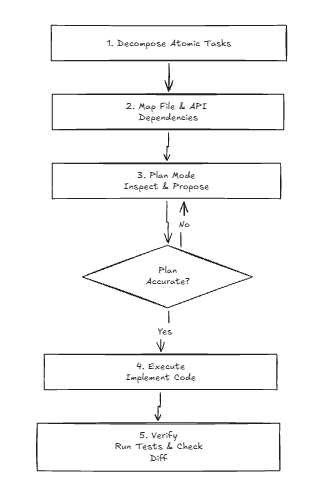
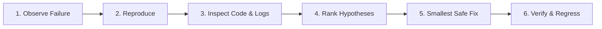

## 1. Core Rule: Eliminate Guessing

Vague prompts force an AI agent to guess architecture, edge cases, and conventions. **Every guess introduces risk.** Professional AI engineering replaces ambiguity with explicit boundaries, verifiable criteria, and a strict **Plan → Approve → Execute → Verify** loop.

---

## 2. Pre-Coding Checklist: What to Do Before Writing Code

Never ask an agent to build a whole system in one shot. Before writing a single line of code, follow these 4 steps:

1. **Decompose into Atomic Tasks:** Break large features into small units with **1 clear outcome**, identifiable files, and explicit dependencies.
2. **Map Dependencies:** Identify what requires a shared contract (e.g., finalize API contract *before* building frontend integration) and what modifies shared files.
3. **Start in Plan Mode (`claude --permission-mode plan`):** Force the agent to read existing code, identify conventions, and propose a step-by-step plan *without modifying files*.
4. **Audit & Approve:** Correct wrong assumptions in the plan first. Never confuse a proposed plan with working code—require test and diff proof afterward.

<p align="center">
  
</p>

### Task Sizing Cheat Sheet

| Too Large (High Risk) | Atomic & Verifiable (Low Risk) |
| --- | --- |
| Build complete authentication | Implement email/password login endpoint |
| Build workspace management | Create `POST /api/workspaces` with validation |
| Build board functionality | Implement board listing query & repository |
| Improve UI | Add workspace creation modal dialog |

---

## 3. The Two Core Engineering Frameworks

### A. The 7-Part Feature Framework

1. **Role:** Engineering persona and tech stack perspective.
2. **Context:** Project name, stack, architecture layers (reference `CLAUDE.md`; don't duplicate it).
3. **Objective:** One single, concrete outcome.
4. **Requirements:** Observable behaviors the feature must perform.
5. **Constraints:** Guardrails—what *not* to modify, add, or break.
6. **Acceptance Criteria:** Explicit `Scenario → Expected Outcome` conditions.
7. **Verification:** Commands to run (unit/integration tests, `git diff`) to prove it works.

### B. The 6-Step Debugging Framework

Never tell an AI to "fix this error"—it will blindly patch symptoms. Force root-cause investigation first:



---

## 4. Copy-Paste Prompt Templates

### Template 1: Pre-Coding Plan Mode (Run Before Coding)

```markdown
# Task Planning & Inspection

## Context
Project: [Project Name]
Stack: [e.g., Node.js, Express, PostgreSQL, Prisma]
Architecture: [e.g., Routes -> Controllers -> Services -> Repositories]
Reference: Follow conventions defined in CLAUDE.md.

## Objective
Design an implementation plan for: [Specific Atomic Feature].

## Instructions
1. Do NOT create or modify any files yet.
2. Inspect existing [models / routes / services / components] related to this feature.
3. Identify file dependencies, shared contracts, and potential edge cases.
4. Output a step-by-step implementation plan listing exact files to create/modify.
5. Wait for my explicit approval before writing code.

```
---
```
### Template 2: Specific Feature Implementation
# Feature Implementation

## Role
Act as a Senior [Backend/Frontend/Full-Stack] Engineer experienced in [Tech Stack].

## Target Scope
- Relevant Files/Modules: [e.g., src/routes/workspaces.ts, src/services/workspaceService.ts]

## Objective
Implement [specific endpoint / UI component / function].

## Requirements
- [Behavior 1: e.g., Validate request payload using existing schema validator]
- [Behavior 2: e.g., Associate record with authenticated user ID]
- [Behavior 3: e.g., Return 201 Created with sanitized object]

## Constraints
- Do not modify unrelated modules or existing authentication flows.
- Do not install new dependencies without justification.
- Reuse existing error-handling middleware and response formats.

## Acceptance Criteria
| Scenario | Expected Outcome |
| :--- | :--- |
| [Valid input] | [201 status + created resource returned] |
| [Missing/invalid input] | [400 validation error] |
| [Unauthenticated request] | [401 unauthorized response] |
| [Database/server error] | [Handled cleanly via error middleware] |

## Verification
1. Write and run unit and integration tests covering all acceptance criteria.
2. Inspect `git diff` to confirm no unintended changes.
3. Report actual test execution output and any remaining limitations.
4. Never claim tests passed unless executed.
```

---

### Template 3: Specific Bug Fix

```markdown
# Bug Investigation & Fix

## Problem
[One-line summary of the bug]

## Expected Behavior
[What should happen]

## Actual Behavior
[What is currently happening]

## Error Output / Logs
[Paste exact stack trace, HTTP status, or failing test output]

## Instructions
1. Do NOT modify any files immediately.
2. Reproduce the failure using existing tests or a minimal test case.
3. Inspect relevant source files, configs, and test fixtures.
4. List potential root causes and rank them using evidence from the codebase.
5. Present the confirmed root cause and propose the smallest safe fix.
6. Wait for my approval before applying changes.

## Verification
- Re-run the failing test to confirm resolution.
- Run related regression tests to ensure zero side effects.
- Review the final diff and report any residual risks.

```

---

### Template 4: Specific Documentation Writing

```markdown
# Technical Documentation

## Role
Act as a Staff Developer Advocate and Technical Writer.

## Context
- Target Audience: [e.g., Backend developers onboarding to HackMate AI]
- Source of Truth: [List actual code files, routes, or schemas to inspect]

## Objective
Write/update [e.g., API Reference for Workspace Endpoints / Setup Guide / Architecture README].

## Requirements
- Inspect the actual codebase first so every endpoint, payload, and env variable matches reality.
- Include:
  1. Overview & prerequisites
  2. Step-by-step setup or usage flow
  3. Request/Response examples with real field names and status codes
  4. Common errors and troubleshooting steps

## Constraints
- Base everything strictly on existing code—do not invent flags, endpoints, or features.
- Keep explanations concise; use tables and code blocks over long paragraphs.
- Do not modify any source code files.

## Acceptance Criteria
- Every code snippet and command runs cleanly against the current codebase.
- All required parameters, types, and error codes are accurately documented.

## Verification
1. Cross-check every documented route/function against actual source files.
2. List any undocumented edge cases or TODOs discovered in the code during inspection.

```