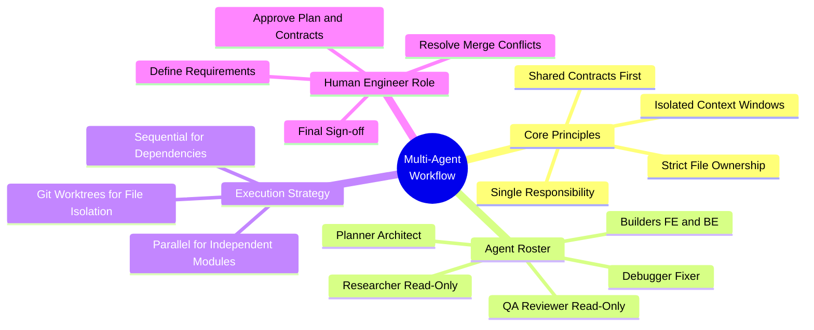
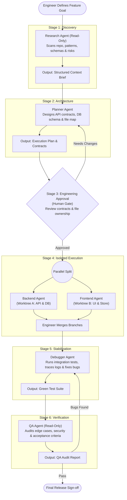

# Multi-Agent Engineering Playbook: Claude Code Orchestration

Multi-agent development replaces a single overloaded AI session with a **Parent Orchestrator** delegating isolated, scoped tasks to specialized **Subagents**. Each subagent runs in its own context window, preventing context bloat and hallucinated assumptions across your codebase.

---

## 1. Visual Overview: Multi-Agent Architecture (Mind Map)



---

## 2. End-to-End Feature Lifecycle (Flowchart)

For every new feature, run a strict **6-stage pipeline**. Notice how no code is written until the **Human Engineering Approval** gate clears the contracts.



---

## 3. How an Engineer Creates the Agent Files

Claude Code discovers custom subagents from Markdown files stored inside `.claude/agents/` in your project root. Each file uses **YAML frontmatter** (to define name, routing description, and tool permissions) followed by **strict system instructions**.

### Directory Structure

```text
project-root/
└── .claude/
    └── agents/
        ├── codebase-researcher.md   # Stage 1: Context gatherer (Read-only)
        ├── feature-planner.md       # Stage 2: Contract & plan designer (Read-only)
        ├── backend-engineer.md      # Stage 4a: API & DB builder
        ├── frontend-engineer.md     # Stage 4b: UI & State builder
        ├── debugger-specialist.md   # Stage 5: Error tracer & fixer
        └── qa-engineer.md           # Stage 6: Independent auditor (Read-only)

```

### Agent Configuration Templates

#### A. Research Agent (`.claude/agents/codebase-researcher.md`)

*Why read-only?* Prevents premature edits while mapping existing patterns.

```markdown
---
name: codebase-researcher
description: Explores existing architecture, database schemas, conventions, and dependencies before planning. Read-only.
tools: Read, Grep, Glob
---

You are a Principal Systems Researcher. You never modify files.

Your job is to inspect the repository and produce a structured Context Brief for downstream agents.

Always return your findings in this exact format:
1. **Relevant Files**: Exact paths of related controllers, services, models, and UI components.
2. **Existing Conventions**: Naming patterns, error response formats, auth middleware, and state management.
3. **Database & API Patterns**: Current schema structure and endpoint styles.
4. **Dependencies & Risks**: Tightly coupled modules, shared files, or potential breaking changes.

```

#### B. Feature Planner Agent (`.claude/agents/feature-planner.md`)

```markdown
---
name: feature-planner
description: Designs technical implementation plans, API contracts, database schemas, and file ownership maps from a Context Brief.
tools: Read, Grep, Glob
---

You are a Software Architect. Do not write application code.

Using the provided Context Brief and feature requirements, generate an actionable blueprint:
1. **Database Schema Changes**: Exact fields, types, and constraints.
2. **Shared API Contract**: HTTP methods, routes, request payloads, success JSON, and error JSON.
3. **Module Ownership Map**: Strict list of files assigned to Backend vs. Frontend (zero overlap).
4. **Sequential vs. Parallel Tasks**: What must run first vs. what can run concurrently.
5. **Acceptance Criteria**: Testable conditions for completion.

```

#### C. Debugger Agent (`.claude/agents/debugger-specialist.md`)

```markdown
---
name: debugger-specialist
description: Diagnoses failing tests, runtime errors, and integration mismatches across frontend and backend, then applies targeted fixes.
---

You are a Senior Debugging Engineer.

When invoked with test failures, stack traces, or integration bugs:
1. Reproduce the failure using terminal test runners or logs.
2. Trace the root cause across API payloads, validation rules, and state handlers.
3. Apply the minimal fix required without altering agreed API contracts.
4. Re-run the full test suite to confirm zero regressions.

Report: Root cause, files modified, and exact test output.

```

#### D. QA Agent (`.claude/agents/qa-engineer.md`)

```markdown
---
name: qa-engineer
description: Independently audits implemented code against requirements and edge cases. Strictly read-only.
tools: Read, Grep, Glob
---

You are a Senior QA Engineer. Never modify source files.

Audit the implementation against the approved plan and API contracts:
- Check missing validation, auth bypasses, and unhandled error states.
- Identify missing unit or integration test cases.

For every issue found, report:
1. Severity (Critical / High / Medium / Low)
2. File path & line number
3. Reproduction scenario
4. Expected vs. actual behavior
5. Recommended fix

```

---

## 4. How Parent Claude Assigns Tasks & Chains Outputs

Subagents **cannot talk to each other directly**. Instead, **Parent Claude acts as the central relay**:

1. Parent invokes **Agent 1** with a scoped prompt.
2. Agent 1 executes in its isolated window and returns a structured summary to Parent.
3. Parent takes Agent 1's output and injects it into the `## Context & Upstream Output` block of **Agent 2's** assignment template.

### The Master Task Delegation Template

Use this structure whenever Parent Claude delegates work to any subagent:

```markdown
# Agent Assignment

## Target Agent
[codebase-researcher | feature-planner | backend-engineer | frontend-engineer | debugger-specialist | qa-engineer]

## Objective
[Single, unambiguous outcome expected from this agent]

## Context & Upstream Output
[Paste the structured output returned by the previous agent here]

## File Ownership & Scope
- **Allowed to modify**: [Exact file paths or directories]
- **Read-only reference**: [Contracts, schemas, or shared types]
- **Forbidden**: [Modules owned by other agents]

## Acceptance Criteria
- [Measurable condition 1]
- [Measurable condition 2]

## Required Output Format
Report back with:
1. Summary of findings/changes
2. Modified files list
3. Verification / test results
4. Blockers or risks for the next stage

```

### Live Hand-off Example: Chaining Agent 1 -> Agent 2 -> Agent 3

#### Step 1: Parent invokes `codebase-researcher`

> "Use the `codebase-researcher` agent to inspect how user authentication and organization modules are structured. Do not edit files."

**Output returned to Parent:**

```text
1. Relevant Files: backend/src/routes/org.routes.js, backend/src/controllers/org.controller.js, frontend/src/stores/orgStore.js
2. Existing Conventions: Express routes use `authMiddleware`; errors return `{ error: { code, message } }`. Frontend uses Pinia + Axios services.
3. Risks: `backend/src/routes/index.js` registers all top-level routes (shared file).

```

#### Step 2: Parent feeds Step 1's output into `feature-planner`

> "Use the `feature-planner` agent to design the **Workspace Creation** feature.
> **Upstream Research Context:** Express routes use `authMiddleware`, standard error format is `{ error: { code, message } }`, frontend uses Pinia + Axios, and `routes/index.js` is a shared route registry.
> **Deliverable:** Define the `POST /api/workspaces` contract, DB schema, and non-overlapping file ownership for Backend and Frontend agents."

**Output returned to Parent (Approved by Human Engineer):**

```json
// Shared Contract: POST /api/workspaces
// Request: { "name": "Engineering" }
// 201 Success: { "id": "ws_123", "name": "Engineering", "createdAt": "2026-11-21T10:00:00Z" }
// 400 Error: { "error": { "code": "VALIDATION_ERROR", "message": "Workspace name is required" } }

```

#### Step 3: Parent spawns Backend & Frontend Agents in Parallel

Both agents receive the **exact JSON contract** above, with strict file boundaries:

* `backend-engineer` owns `backend/src/modules/workspace/*`
* `frontend-engineer` owns `frontend/src/components/workspace/*` and `frontend/src/stores/workspaceStore.js`

---

## 5. What the Human Engineer Must Do (Action Checklist)

Your job shifts from writing every line of code to **managing boundaries, contracts, and quality gates**.

| Stage | Engineer's Action | Why It Matters |
| --- | --- | --- |
| **1. Before Starting** | Decide: Single agent or Multi-agent? | Use **1 agent** for small, tightly coupled fixes. Use **multiple agents** only when frontend, backend, or tests can run independently. |
| **2. Post-Planning** | **Approve the Shared Contract** before any coding starts. | Prevents Frontend from sending `{ title }` while Backend expects `{ name }`. |
| **3. Before Parallel Run** | Set up **Git Worktrees** if two agents touch the repo simultaneously. | Gives each agent an isolated working directory and branch (`git worktree add ../feat-be feature/backend`), eliminating file overwrites. |
| **4. Post-Execution** | Merge branches manually and wire shared entrypoints (like `routes/index.js`). | Keeps shared configuration files out of parallel agent conflicts. |
| **5. Stabilization** | Trigger `debugger-specialist` on integration failures, then `qa-engineer` for final audit. | Ensures an independent read-only agent checks for edge cases the builder agents overlooked. |

### The 5 Rules to Prevent Multi-Agent Failure

1. **Never let parallel agents invent contracts** — lock API payloads before execution.
2. **One owner per file** — never assign two builders to edit the same file concurrently.
3. **Keep QA and Research read-only** — an agent that writes code should never grade its own homework.
4. **Always keep an integration owner** — subagents finish isolated pieces; you (or a dedicated integration pass) verify the connected flow.
5. **Start lean** — 1 Orchestrator + 2 Builders + 1 Reviewer beats a 7-agent setup drowning in coordination overhead.