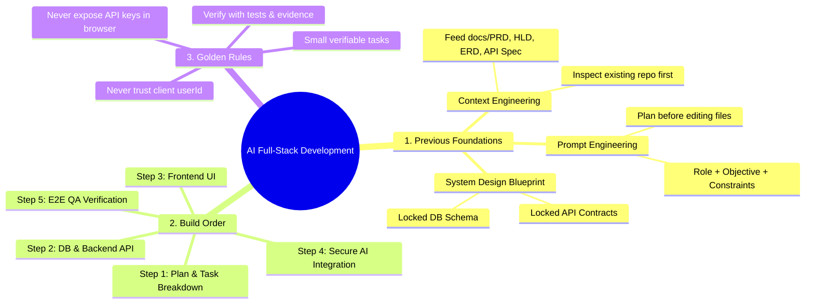
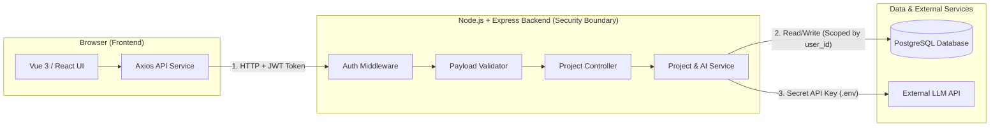
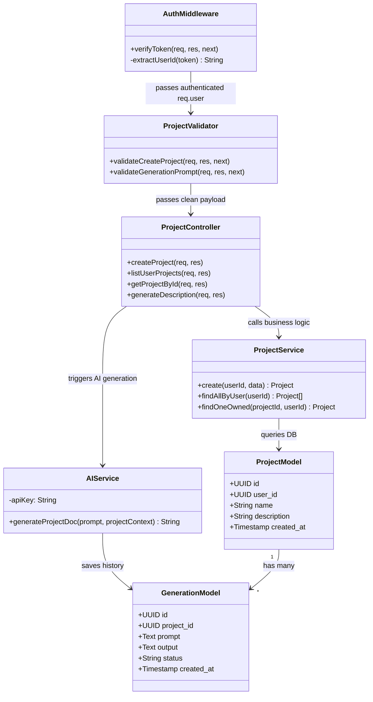
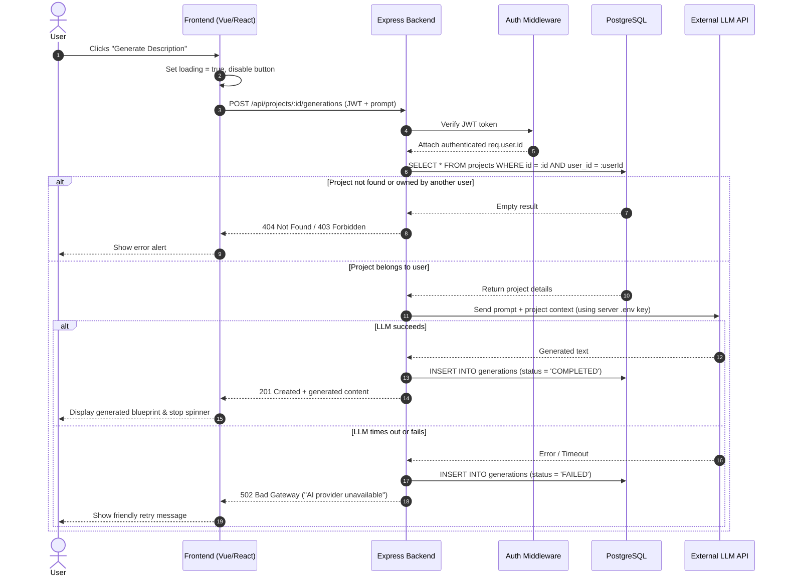

# From Blueprint to Working Product: Full-Stack Development with AI Coding Agents

> **Where You Are Now:** You have already mastered **Prompt Engineering** (how to instruct AI), **Context Engineering** (feeding the right docs and rules), and **AI System Design** (generating your `docs/` folder: PRD, HLD, ERD, and API Contracts).
> **Today's Mission:** Use those exact blueprint documents to build a real, secure full-stack application—step by step—without letting the AI agent hallucinate, break architecture, or create messy code.

---

## 1. The Big Picture: How Everything Connects

Beginners fail with AI coding agents because they open a terminal and say: *"Build my app."*

Professional engineers treat an AI coding agent like a **fast junior developer** who needs clear blueprints, small tickets, and strict code reviews.



---

## 2. System Architecture & Code Structure (Visualized)

Before writing prompts, understand **what** we are building (using **HackMate AI** as our reference project) and **how** the code is organized.

### A. System Architecture & Security Boundary

Notice where the **External LLM API** sits. A common beginner mistake is calling OpenAI/Claude directly from the frontend browser—which exposes your secret API key to anyone who opens Chrome DevTools.



### B. Backend Class & Module Design (Separation of Concerns)

Beginners often dump database queries, validation, and AI calls inside one giant route file. Instead, instruct your AI agent to follow this clean 4-layer structure:



### C. End-to-End Request Lifecycle (Sequence Diagram)

Here is the exact step-by-step flow when a user clicks **"Generate AI Description"** in the UI:



---

## 3. The 5-Step AI Development Playbook

> **Context Engineering Tip:** Before running Step 1, make sure your blueprint files from the System Design phase (`docs/PRD.md`, `docs/HLD.md`, `docs/ERD.md`, `docs/API_SPEC.md`) are saved inside your project repository so the agent can read them directly.

---

### Step 1: Repo Inspection & Task Breakdown (Plan Mode)

* **Why this matters:** Never let an AI agent edit files before it understands what already exists in your repository. Use **Plan Mode** (e.g., `claude --permission-mode plan`) to turn your `docs/` blueprint into a checklist of small tickets.
* **Beginner Check:** Before approving the plan, verify:
1. Did the agent actually read your existing `package.json` and folders?
2. Did it separate **Database -> Backend -> Frontend -> AI Integration**?
3. Did it include **automated tests** for every feature?


#### Customizable Prompt Template (Step 1)

```text
# Role
Act as a Senior Full-Stack Engineer and Technical Lead.

# Context
We are building [PROJECT_NAME].
Read our architecture documents in `docs/` (PRD, HLD, ERD, and API Spec) before responding.

Our stack:
- Frontend: [FRONTEND_STACK, e.g., Vue 3, Vuetify, Axios]
- Backend: [BACKEND_STACK, e.g., Node.js, Express.js]
- Database: [DATABASE, e.g., PostgreSQL]
- External Services: [EXTERNAL_APIS, e.g., OpenAI / Anthropic API]

# Objective
Inspect the existing repository and convert our architecture into a step-by-step implementation plan.

# Requirements
1. Inspect existing files, dependencies, and configuration first.
2. Break implementation into small, independently verifiable tasks.
3. Group tasks cleanly: Database -> Backend API -> Frontend UI -> AI Integration.
4. Map dependencies between tasks (what must be built first).
5. Include unit/integration testing tasks for every module.
6. Flag any missing environment variables, ambiguities, or risks.

# Constraints
- Do NOT modify or create any files.
- Do NOT install packages yet.
- Do NOT generate implementation code.
- Clearly distinguish existing repository facts from your recommendations.

# Expected Output
1. Current repository audit.
2. Proposed folder structure.
3. Numbered implementation task list with dependencies.
4. Clear "Definition of Done" (acceptance criteria) for every task.

```

---

### Step 2: Database Migrations & Backend Core API

* **Why this matters:** Always build the **Database + Backend first**. Once your backend endpoints match the API Contract, your frontend has a stable target to connect to.
* **Critical Security Rule:** Never trust a `userId` sent inside the request body (`req.body.userId`). Always extract `userId` from the verified authentication token on the server (`req.user.id`), and include `WHERE user_id = $2` in every database query.

#### Customizable Prompt Template (Step 2)

```text
# Role
Act as a Senior Backend Engineer.

# Context
Refer to our approved plan and `docs/ERD.md` + `docs/API_SPEC.md` for [PROJECT_NAME].

# Objective
Implement the database schema/migrations and core CRUD APIs for [CORE_RESOURCE, e.g., Projects].

# Endpoints to Implement
- POST /api/[RESOURCE] (Create)
- GET /api/[RESOURCE] (List user's items)
- GET /api/[RESOURCE]/:id (Get single item details)

# Requirements
1. Create database tables/migrations matching `docs/ERD.md`.
2. Separate concerns into `routes/`, `validators/`, `controllers/`, and `services/`.
3. Validate all incoming payloads and return 400 with clear error messages on invalid input.
4. Handle missing records (404) and unexpected DB errors (500) cleanly via error middleware.
5. Write automated integration tests covering happy paths, invalid payloads, and unauthorized access.

# Critical Security Requirements
- Protect all endpoints with authentication middleware.
- Never accept `userId` from request body or query params—derive it solely from `req.user.id`.
- Enforce strict ownership on every read, update, and delete query.
- Never leak stack traces or secrets in API responses.

# Constraints
- Inspect existing backend files first and follow project conventions.
- Do not modify unrelated files.
- Do not claim tests pass unless you actually execute them.

First present your brief file-by-file plan and wait for my approval before writing code.

```

---

### Step 3: Frontend UI & API Integration

* **Why this matters:** Keep your UI components clean. Never write raw `fetch()` or `axios.post()` calls scattered across dozens of buttons and modals—centralize them in an `api/` service layer so backend URL changes happen in one place.
* **UX States Every Beginner Forgets:** Every screen that talks to an API needs **4 states**:
1. **Loading** (spinner/skeleton while waiting)
2. **Empty** (friendly message when the user has 0 projects yet)
3. **Success** (data rendered cleanly)
4. **Error** (clear alert banner if the server fails)


#### Customizable Prompt Template (Step 3)

```text
# Role
Act as a Senior Frontend Engineer.

# Context
We are building the frontend for [PROJECT_NAME] using [FRONTEND_STACK, e.g., Vue 3 Composition API, Vuetify, Axios].
The backend API endpoints (`POST /api/[RESOURCE]`, `GET /api/[RESOURCE]`, `GET /api/[RESOURCE]/:id`) are already implemented.

# Objective
Implement the [FEATURE_NAME, e.g., Project Dashboard and Details Page].

# Requirements
1. Create a dedicated API client service (e.g., `src/services/[resource].api.js`)—keep HTTP calls out of UI components.
2. Build the list/dashboard view displaying the user's records.
3. Build a creation form/dialog with client-side validation.
4. Build the detail view page with routing (`/projects/:id`).
5. Implement explicit Loading, Empty, Success, and Error states on every view.
6. Ensure responsive layout for both desktop and mobile screens.

# Constraints
- Inspect existing frontend components, router, and state management first.
- Reuse existing theme/UI components—do not invent a new design system.
- Do not hardcode mock data.
- Do not modify backend files.

Propose your component structure and implementation plan first. Wait for approval before editing files.

```

---

### Step 4: Secure External AI Integration

* **Why this matters:** External LLM APIs are unpredictable—they can take 5–15 seconds, hit rate limits, or return malformed text. Your backend must wrap the AI call in proper timeouts, validation, and database history logging.
* **Security Checklist:**
* API key lives **only** in backend `.env` (which is listed in `.gitignore`).
* Commit `.env.example` with dummy placeholders (`LLM_API_KEY=your_key_here`).
* Frontend calls your backend (`POST /api/projects/:id/generations`), never the LLM provider directly.


#### Customizable Prompt Template (Step 4)

```text
# Role
Act as a Senior AI Backend Engineer.

# Objective
Implement the backend AI generation endpoint (`POST /api/[RESOURCE]/:id/generations`) and connect it to the frontend UI.

# Backend Workflow Required
1. Authenticate user via middleware.
2. Verify the parent `[RESOURCE]` exists AND belongs to `req.user.id`.
3. Validate the incoming `prompt` payload.
4. Call [LLM_PROVIDER, e.g., Anthropic / OpenAI] via a dedicated `ai.service.js` module.
5. Save the generation record (prompt, output, status) in the database.
6. Return `201 Created` with the saved generation ID and content.
7. Handle provider timeouts, rate limits, and errors gracefully (return `502 Bad Gateway` without crashing the server).

# Security & Hygiene Rules
- Read API keys strictly from `process.env`.
- Verify `.env` is in `.gitignore` and update `.env.example` with placeholder keys.
- Never log raw API keys or sensitive user tokens.

# Constraints
- Inspect existing backend code and installed SDK versions before writing code.
- Do not invent SDK methods—check `package.json` for the exact library installed.
- Add unit tests mocking both a successful LLM response and a failed/timed-out LLM response.

Propose your implementation plan before modifying files.

```

---

### Step 5: End-to-End Verification & Adversarial QA Audit

* **Why this matters:** AI agents often say *"Everything is complete!"* even when a route has a typo or an authorization check is missing. Switch the agent's persona to an **Independent QA Engineer** whose only job is to break your app and verify every requirement with real evidence.

#### Human + AI 10-Point E2E Acceptance Checklist

Run through this manually before your hackathon demo:

* [ ] **1. Database starts** cleanly with zero connection errors.
* [ ] **2. Migrations run** from scratch without manual SQL fixes.
* [ ] **3. Backend starts** and `/health` (or test endpoint) responds `200 OK`.
* [ ] **4. Frontend starts** with zero console errors.
* [ ] **5. Create flow works** end-to-end through the UI.
* [ ] **6. Persistence works:** Hard-refresh the browser (`Ctrl+R`) and verify data remains.
* [ ] **7. AI generation works:** Submit a prompt, see the loading spinner, and receive saved output.
* [ ] **8. History persists:** Refresh the details page and verify generated AI content reloads from PostgreSQL.
* [ ] **9. Security isolation works:** Log in as User B and try accessing User A's project URL/ID—confirm access is blocked (`403`/`404`).
* [ ] **10. Failure resilience works:** Temporarily put an invalid LLM API key in `.env`, trigger generation, and confirm the UI shows a clean error message instead of crashing.

#### Customizable Prompt Template (Step 5 — QA Audit)

```text
# Role
Act as an independent Senior QA and Application Security Engineer.

# Objective
Perform a strict code and test audit of [PROJECT_NAME] across the backend, database, frontend, and AI integration workflows.

# Audit Checklist
1. Verify all endpoints match `docs/API_SPEC.md` (paths, HTTP status codes, JSON shapes).
2. Verify authentication and row-level ownership checks on every database query.
3. Confirm secrets are never exposed to the frontend or logged to stdout.
4. Check frontend handling of loading, empty, and API error states.
5. Verify external LLM timeout and failure handling.
6. Run the full automated test suite and inspect real test outputs.

# Constraints
- Do NOT modify any application code during this audit.
- Never mark an item as "Verified" without citing the exact file/line or test execution output as evidence.

# Expected Output
1. Verified Working Behaviors (with evidence).
2. Security Vulnerabilities or Isolation Gaps (ranked High/Medium/Low).
3. Reproducible Bugs or Contract Mismatches.
4. Missing Test Coverage.
5. Prioritized Fix List.

```

---

## Quick Troubleshooting Cheat Sheet (When the Agent Gets Stuck)

| Symptom | Why It Happens | What to Tell the Agent |
| --- | --- | --- |
| Agent rewrites working files unnecessarily | Context window drifted or task was too broad | *"Revert changes to `[file]`. Only modify `[target_file]` and keep existing interfaces intact."* |
| Frontend gets `CORS` or `404` errors | API path mismatch between frontend service and Express router | *"Compare `frontend/src/services/*.js` URLs line-by-line against `backend/src/routes/*.js` and fix the mismatch."* |
| Agent invents fake SDK methods for OpenAI/Claude | Training data mismatch with installed library version | *"Inspect `backend/package.json` for the exact SDK version installed, check `node_modules` types if needed, and rewrite the call using valid syntax."* |
| Agent says "Tests pass" without running them | Agent assumed code works statically | *"Execute `npm test` in the terminal now and paste the raw test runner output."* |