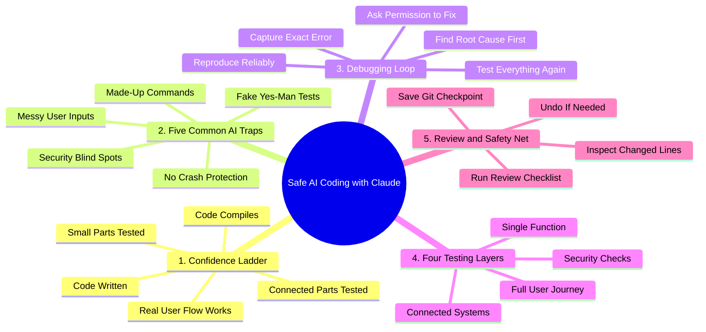
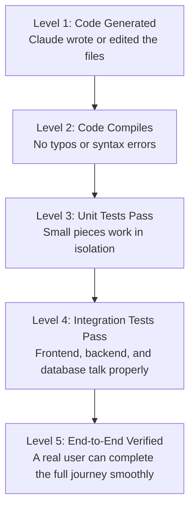
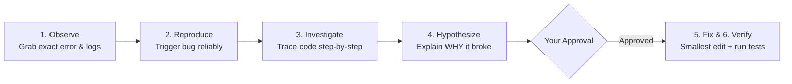
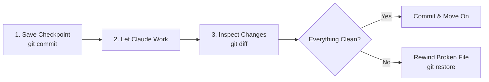

### Debugging, Testing and REviewing with ai

## Big Picture Mindmap



---

## 1. The Golden Mindset: Don't Trust "All Tests Passed!"

When Claude finishes a task and says *"Everything is working properly,"* treat it like a confident junior teammate—verify the evidence before accepting it.

Working code climbs **five levels of trust**:



> **Key takeaway:** Passing Level 3 (small tests) does **not** guarantee Level 5 (the whole app actually works for a real person). Always give Claude an actual check to run—like a test suite or build command—so it verifies its own work rather than stopping when the code merely "looks done".

---

## 2. The 5 Classic Traps in AI-Generated Code

Claude writes fast, clean-looking code, which makes mistakes easy to miss. Watch out for these five habits:

### Trap 1: Made-Up Commands (Hallucinated APIs)

Claude sometimes invents a shortcut method that does not exist in your installed library.

* **The mistake:** `await axios.getData("/api/projects")` *(There is no `.getData()` in Axios)*
* **The fix:** `await axios.get("/api/projects")`
* **How to catch it:** Run the code, check your installed package version, and look at official docs if something throws an "undefined function" error.

### Trap 2: Security Blind Spots (Missing Ownership Checks)

Claude often builds the "happy path" where things work, but forgets to lock doors against unauthorized users.

* **The mistake:** Looking up a project using only `Project.findById(req.params.id)`. Anyone who guesses a project ID can view someone else's private work.
* **The fix:** Always check both the project ID **and** the logged-in user's ID on the server:
```javascript
const project = await Project.findOne({
  _id: req.params.id,
  userId: req.user.id
});

```


### Trap 3: Ignoring Messy Inputs (Missing Edge Cases)

AI usually assumes users type normal, polite data. Real users click twice, leave boxes blank, or paste massive text.

| Messy Situation | What Your App Must Do |
| --- | --- |
| **Blank project name** | Block it and send a clear `400` validation message |
| **10,000-character name** | Enforce a character limit before saving |
| **Broken or fake ID** | Return a clean `400` or `404` instead of crashing |
| **Database goes offline** | Show a safe error message instead of freezing |
| **User not logged in** | Block immediately with `401` Unauthorized |
| **Opening someone else's data** | Deny access completely |
| **Double-clicking "Submit"** | Prevent creating duplicate records |

### Trap 4: No Crash Protection (Poor Error Handling)

* **The mistake:** Saving directly to a database without a safety net. If the database hiccups, the entire server crashes or leaks technical secrets to the user.
* **The fix:** Wrap risky actions in `try / catch` blocks (or a central error handler) so failures log quietly on your server while the user sees a clean `"Unable to create project"` message.

### Trap 5: Fake "Yes-Man" Tests

When asked to write tests, AI sometimes writes tests that prove nothing just to make the checkmark turn green.

* **Useless test:** `expect(true).toBe(true)` *(Always passes even if your app is completely broken)*
* **Real test:** Send a `POST` request with a real login token, check that status `201` comes back, confirm the saved name matches, and verify it actually exists in the database.

---

## 3. How to Debug with Claude (Without Letting It Guess)

If you tell Claude *"The dashboard is broken, fix it,"* it will randomly rewrite files until the error message disappears—often breaking two other things in the process.

Force Claude to follow this **6-step detective loop** instead:



### Template 1: Bug Investigation & Reproduction Prompt

*Use this whenever something breaks. Notice how it bans Claude from editing files until you approve the diagnosis.*

```markdown
Act as a Senior Full-Stack Debugging Engineer.

## The Bug
[Describe what is happening vs. what should happen. Paste exact error logs here.]

## Your Task
Find the exact root cause before making any code changes.

## Step-by-Step Process
1. Write down the exact steps to reproduce this bug reliably.
2. Trace the data flow from frontend request -> API route -> database -> response.
3. Check if the data format sent by the backend matches what the frontend expects.
4. Separate confirmed facts (from logs/code) from guesses.

## Strict Rules
- DO NOT modify or create any files yet.
- DO NOT guess or rewrite unrelated code.
- DO NOT print passwords, API keys, or tokens in logs.

## What to Show Me
1. How to reproduce the bug.
2. Evidence you found in the code.
3. The exact root cause in plain English.
4. The smallest fix needed.
5. Which tests we should run after fixing it.

Stop and wait for my approval before editing any code.

```

---

## 4. How to Test Your App Properly

You need four layers of testing so bugs cannot hide between parts of your app:

1. **Unit Tests (Single Building Blocks):** Tests one tiny function on its own (e.g., *"Does `validateProjectName()` reject empty strings?"*).
2. **Integration Tests (Connected Parts):** Tests whether your API and database work together properly.
3. **End-to-End Tests (Full User Journey):** Simulates a real person logging in, creating a project, refreshing the page, and seeing their work.
4. **Security Tests (Locked Doors):** Confirms User A cannot read, edit, or delete User B's data.

### Template 2: Risk-Based Testing Prompt

*Use this after building a feature to uncover blind spots.*

```markdown
Act as a Principal QA Automation Engineer.

Review the current feature implementation and build a practical test plan.

For every feature, cover:
1. Normal usage (happy path).
2. Unusual or empty inputs (boundary conditions).
3. Network or database failures.
4. Security and permission checks (making sure users can only access their own data).

Then inspect our existing tests and tell me what is missing.

Rank the missing tests by risk:
- Critical: Security holes, data loss, or broken main user flows.
- High: Core features failing under normal use.
- Medium: Missing validation or ugly error states.
- Low: Minor visual glitches.

Rules:
- Do not modify any application files.
- Do not claim a test exists unless you actually see it in the codebase.
- Give me specific test cases with clear expected results.

```

---

## 5. How to Review Claude's Code Like a Staff Engineer

Right after Claude finishes building or fixing something, run a review before you commit the code.

> **Pro Tip:** Keep a short `CLAUDE.md` file in your project root listing your team's ground rules (preferred libraries, folder rules, and test commands). Claude reads this automatically so you don't have to repeat your standards every time.

### The 8-Point Quick Review Checklist

* **Correctness:** Does this actually solve what I asked for?
* **Architecture:** Is database logic kept cleanly separate from UI/route code?
* **Security:** Are login and ownership checks enforced on the server?
* **Reliability:** What happens if an external API times out or fails?
* **Performance:** Is the code running unnecessary loops or repeated database calls?
* **Maintainability:** Can a human read and understand this in 6 months?
* **Testing:** Are failure cases tested, not just the happy path?
* **Scope:** Did Claude sneak edits into unrelated files?

### Template 3: Post-Task Code Review Prompt

*Copy and paste this right after Claude finishes any task.*

```markdown
Act as a Staff Software Engineer reviewing a Pull Request.

Review ONLY the current uncommitted changes (git diff).

Check for:
1. Logic mistakes or missed requirements.
2. Security holes (missing login or user-ownership checks).
3. Missing error handling or crash risks.
4. Slow database queries or wasted network calls.
5. Overly complicated code that is hard to maintain.
6. Missing tests for failure cases.
7. Accidental edits to files outside the task scope.

For each issue found, tell me:
- Severity: Critical / High / Medium / Low
- File name and line number
- What is wrong (in plain English)
- Why it matters
- How to fix it

Strict Rules:
- Do not edit any files.
- Do not complain about minor style preferences.
- Only report real issues backed by evidence in the code.

End with a clear verdict: Approve / Request Changes / Needs Investigation.

```

---

## 6. Git: Your Built-In "Undo" Button

Never let an AI edit multiple files without a quick save point. If Claude goes down a rabbit hole and breaks working code, Git lets you rewind in two seconds.



### Everyday Git Safety Cheat Sheet

| Command | Plain-English Meaning | When to Use It |
| --- | --- | --- |
| `git add . && git commit -m "checkpoint"` | **Save your game.** Locks in your current working code. | **Before** asking Claude to make big or risky changes. |
| `git status` | **Show touched files.** Lists every file Claude created or modified. | Right after Claude finishes a task, to ensure it didn't touch unrelated files. |
| `git diff` | **Show exact line changes.** Green lines were added; red lines were removed. | Before approving Claude's work—read every changed line yourself. |
| `git restore path/to/file` | **Undo changes to one file.** *(Warning: permanently discards uncommitted edits in that file).* | When Claude messes up a specific file and you want the clean version back. |
| `git log --oneline -5` | **Show last 5 save points.** | When you want to check your recent commit history. |